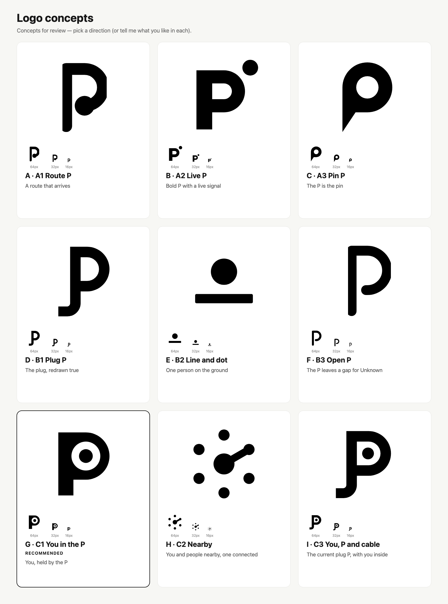
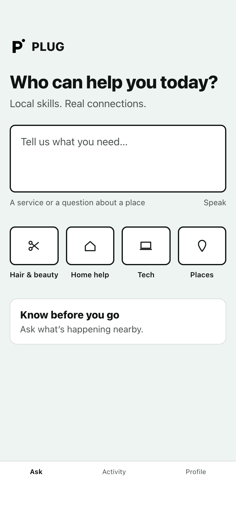
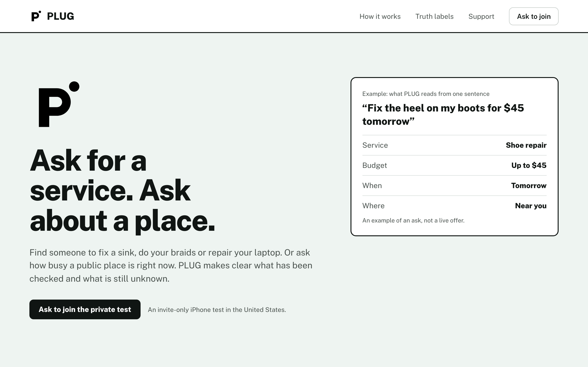
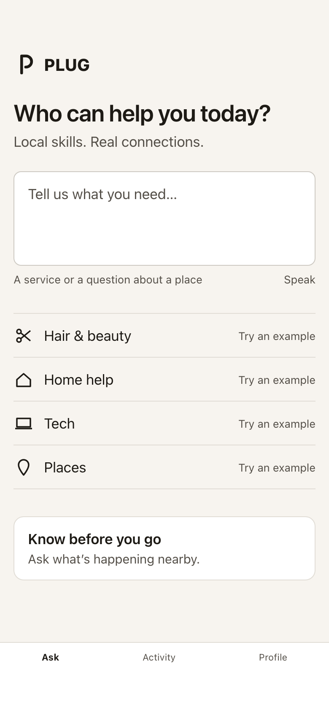
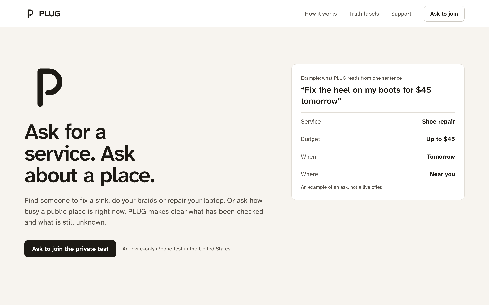
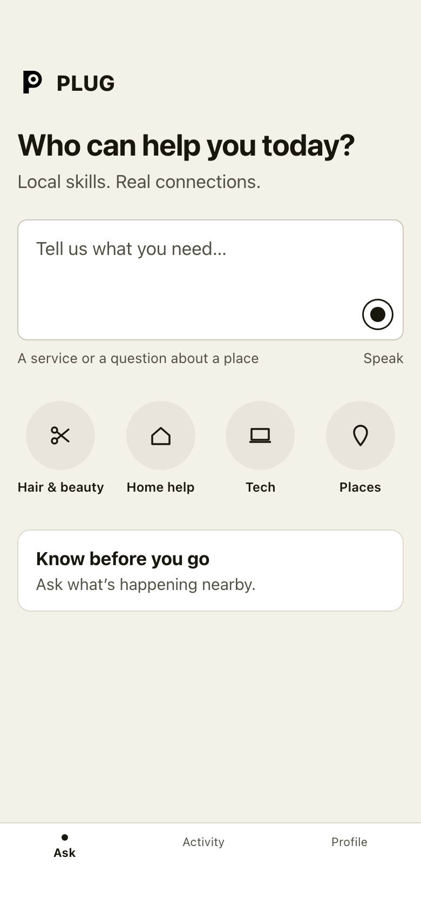
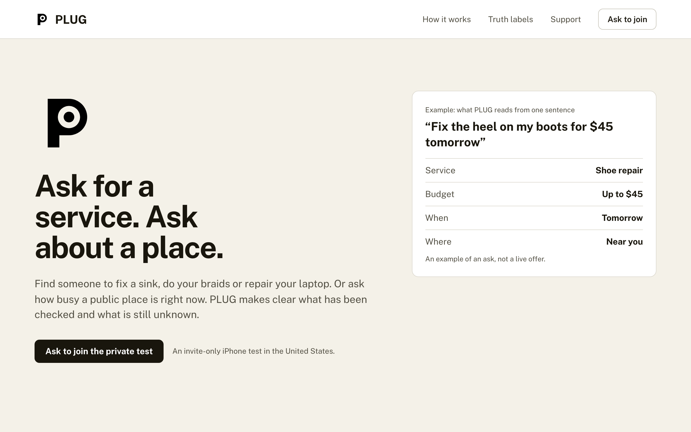

# PLUG redesign: three directions

2026-11-15. The owner (Person One) authorised this redesign. This document asks for one decision: which direction to build.

## What the manual fixes, whichever direction wins

Manual §10, §11, §16 and ADR-010 already settle a lot. None of the directions below breaks these rules:

- Colour is evidence. The primary button and the mark are ink. Saturated colour exists only in the four truth labels and in alert.
- One type family per platform. On iOS it is the system face (SF Pro). On web it is Public Sans, and changing it needs a formal design-system decision (direction B asks for one).
- Spacing uses the 4/8/12/16/24/32/48/64 scale. Radii are 7 (badge), 9 (control), 12 (card) and 20 (sheet). Nothing has a shadow, and no surface is a pill.
- Filled badges mean a person confirmed it. A dashed outline means the information came from the web.
- No dark mode in V1. Every motion stops under Reduce Motion and `prefers-reduced-motion`.

So the directions differ in the things the manual leaves open: the mark, the warmth of the neutrals, how rules and lines are drawn, type weight and density, icon treatment, and how things move.

New in every direction: a `rule.control` token for field and control borders at 3:1 or better against both card and paper. Today field borders use `rule.300` at about 1.7:1, which fails WCAG 1.4.11.

Contrast for every text pair in every palette is in [contrast.md](contrast.md), with all 54 checks at AA. OKLCH sources and hex values are in [palettes.json](palettes.json). The sample screens use the real app and site copy; only "Try an example" in sample B is placeholder text.

## A. Signal

**Idea:** PLUG as street signage for what is happening near you. It is bold, readable at arm's length, and live.

- **Mark:** A2 "Live P", a heavy geometric P with a separate live dot. Alternates: A1 Route P, A3 Pin P (A3 leans on the map-pin cliché).
- **Type:** SF Pro on iOS and Public Sans on web, both at heavy weights. Display is 800 with -0.9 tracking. Values such as price, wait and distance set big and bold, signage style.
- **Palette (OKLCH):** cool green-grey neutrals at hue 165, chroma 0.007. Paper `#EEF4F1`, ink `#101513`, ink.600 `#4A524E`, control border `#878E8B`.
- **Spacing:** dense. 16 gutters, 24 between groups, 32 between sections.
- **Lines and corners:** 2px ink rules carry structure (header edge, example card). Category tiles are bordered sign tiles at radius 9.
- **Icons:** SF Symbols in semibold, inside 64pt bordered tiles.
- **Motion:** quick and decisive. Springs with response 0.28 and damping 0.86, about 200 ms, with no bounce. Transitions are an 8pt slide plus a cross-fade. Logo reveal: the P sets in place, then the live dot switches on, about 0.8 s.
- **Risk:** heavy type and 2px rules can feel loud next to a calm Unknown state. The live dot must never imply live data where there is none.

 

## B. Ledger

**Idea:** PLUG as an honest record. Every value says where it came from, laid out like a clear receipt.

- **Mark:** B3 "Open P", a monoline P whose bowl stops short of the stem, leaving room for what is not known. Alternates: B1 Plug P (keeps the current cable tail), B2 Line and dot.
- **Type:** SF Pro Semibold for titles, with tabular figures for every value. On web, Atkinson Hyperlegible Next (OFL), chosen for legibility outdoors and on small screens. **Needs a formal design-system decision (ADR)**, because §16.5 names Public Sans.
- **Palette (OKLCH):** warm stone neutrals at hue 80, chroma 0.008. Paper `#F7F4EF`, ink `#1D1A15`, ink.600 `#544F48`, control border `#8F8C85`.
- **Spacing:** generous. 24 gutters, 48 between sections, values in right-aligned key/value columns.
- **Lines and corners:** 1px hairlines. Discovery is a ruled list rather than tiles.
- **Icons:** SF Symbols in regular weight, inline in rows.
- **Motion:** calm. Ease-out `cubic-bezier(0.2,0,0,1)` at 220-300 ms, no overshoot, cross-fades only. Logo reveal: the P draws as one stroke and stops at its gap, about 0.9 s.
- **Risk:** the quietest of the three. It can read as a utility with no character, and the font change costs Person Two a migration.

 

## C. Nearby (recommended)

**Idea:** PLUG puts you in the middle of real people near you. The mark is you, held inside the P.

- **Mark:** C1 "You in the P", a solid P whose counter holds a dot: you, with a ring of space around you that the people nearby fill. Alternates: C2 Nearby (you plus six nearby, one connected), C3 (keeps the current cable tail).
- **Type:** SF Pro Bold for titles. The wordmark is custom-drawn, so it no longer depends on SF Rounded Heavy text. Public Sans 700 on web, so no font migration.
- **Palette (OKLCH):** warm paper neutrals at hue 92, chroma 0.012. Paper `#F4F1E8`, ink `#19160D`, ink.600 `#535044`, control border `#89867C`.
- **Spacing:** 16 gutters, 32 between sections.
- **Lines and corners:** 1px rules. The circle is the one extra shape, and it is used for one meaning only: a person. "You" and people nearby are circles everywhere (mark, composer, progress); nothing else is round.
- **Icons:** SF Symbols in regular weight, inside 64pt round wells.
- **Motion:** physical and small. Springs with response 0.35 and damping 0.82, 150-350 ms. Logo reveal, under 1.2 s: the dot (you) appears, a ring forms around it, the P closes around both. The animation says "a person, connected to people nearby". Progress uses one dot per person the server says was contacted, filled when that person replies. The counts come from the server, and nothing animates without a server event.
- **Risk:** the dot motif turns into decoration if it is used for anything other than a person. It also needs a trademark search: P-with-a-dot marks exist.

 

## Recommendation

**C. Nearby.** It is the only direction where the brand motif carries product truth: one circle is one real person. That gives the progress screen an honest visual (contacted versus replied, from server counts), gives the animated logo a reason to exist, and keeps the P the owner chose on 2026-10-08. It reads best at 16 px of the nine marks, and it needs no font migration on the web.

## References studied

See [references/](references/) for the `/taste` analyses of the six reference sites. The redesign takes principles only: no logos, copy or imagery.
