# iOS UI pass, 2026-11-14

Owner-authorized pass on the iOS app (branch `p3.ui-one-ios-polish`, state entry
`P3-ui-pass-ios`). It changes how screens are drawn, never what they show: no data, copy,
contract, backend or token change. Token proposals for Person Two are in
[proposals/ui-pass-2026-11-14.md](proposals/ui-pass-2026-11-14.md).

Screenshots come from `tools/run-phase2-ui-evidence.sh` on the synthetic fixture server
(iPhone 17 Pro simulator, default and largest Dynamic Type). The before set mixes fresh
captures with 2026-10-08 copies, see [its README](../../evidence/ui-pass/2026-11-14/before/README.md).

## Changes and why

| # | Change | Why (manual) | Commit |
| --- | --- | --- | --- |
| D1 | Every heading and value on the PLUG type ramp (`plugText`); SF Rounded removed, except the logotype | §16.8 one family, §16.1 unscaled ramp. Owner chose this over keeping ADR-012's rounded headings | `fe2b285` |
| D2 | One card style (`plugCard`: radius 12, 1px rule border); every radius a token; chips square-cornered; pressed and disabled buttons change fill, not opacity; multi-line labels centred | §16.8 radius by role, §16.1 pill-button ban, §11.1 never fade a live control | `5c30e29` |
| D3 | Spacing and touch targets on the token scale (4/8/12/16/24) | Rhythm was eyeballed at 5, 6, 10, 14, 18, 20, 22 | `3865465` |
| D4 | Home photo card: photo above, ink text on the card below, no gradient | §16.1 gradient ban; the accessibility audit failed contrast on today's main. Owner chose to keep the photo | `de47105` |
| D5 | Decorative icon tiles on state cards and arrows on button text removed | §16.2 icons as decoration; the value or state title now leads | `7c23136` |
| D6 | Offer detail card full width, category grid top-aligned, disclosure rows 44pt, Not verified dashed outline at 3:1 (`ink400`), composer and chip glyphs scale with text | §16.8 alignment, touch targets, non-text contrast | `cc0520d` |
| R2 | Design-gate round 2 fixes: every card bordered, one ink primary per screen, View details centred, leftover icons gone, Profile rows on the ramp, provider cards without doubled padding | §16.8 findings on the after screenshots | `e7b74fd` |
| R3 | The composer keeps whole words at accessibility sizes; page containers set `ink900`, so no text falls back to system black | Regression from D6 found by the gate; §16.8 says every colour is a token | `f0fc636` |

## Before and after

| Screen | Before | After |
| --- | --- | --- |
| Ask home | 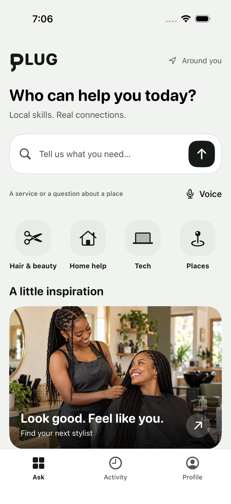 | 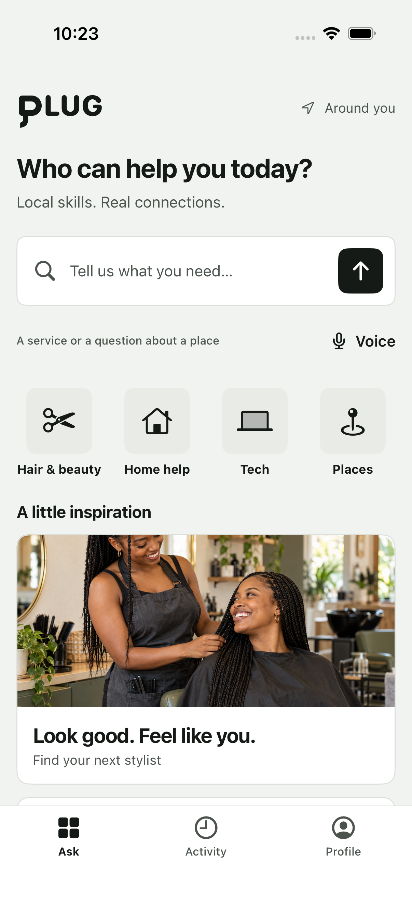 |
| Home with an active ask | 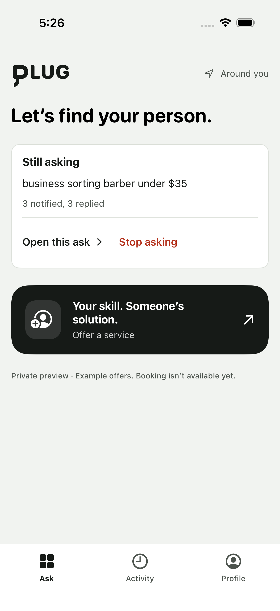 | 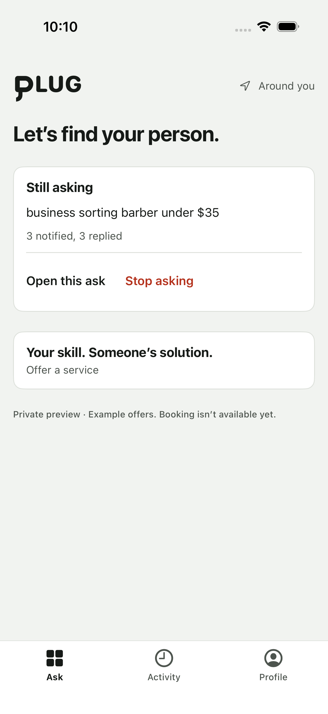 |
| Offers | 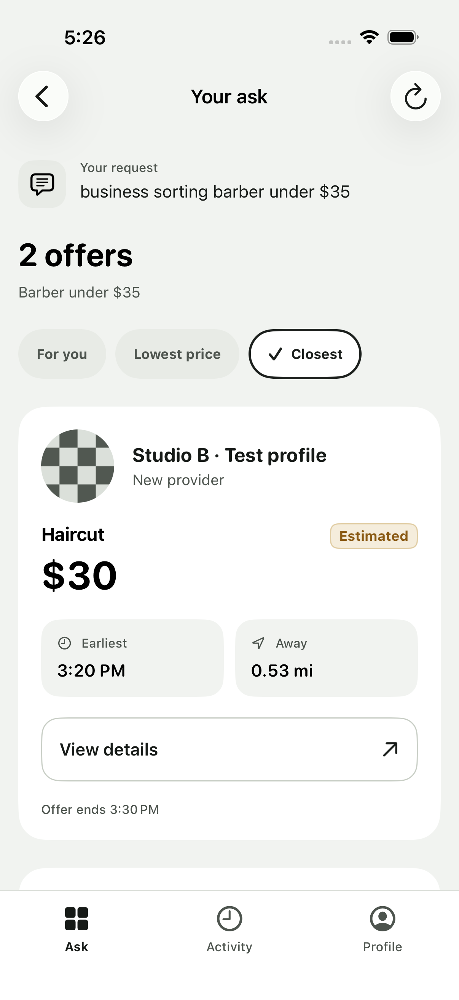 | 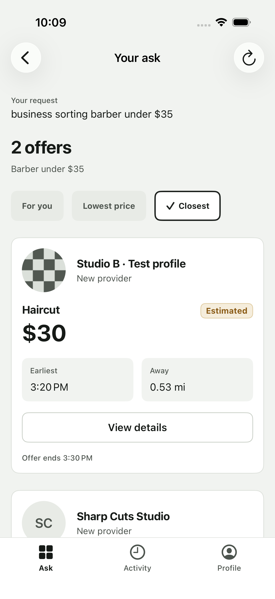 |
| Offer detail | 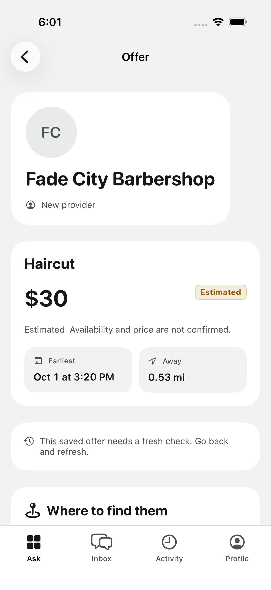 | 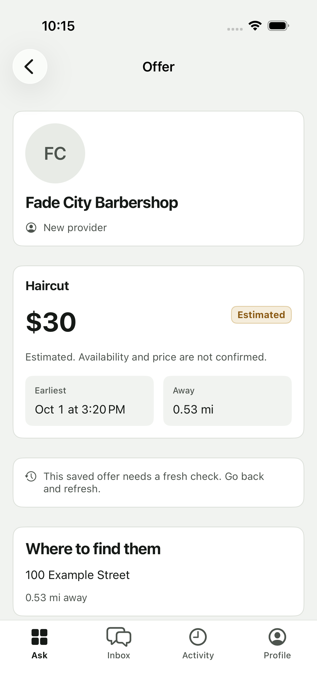 |
| Offer detail, largest text | 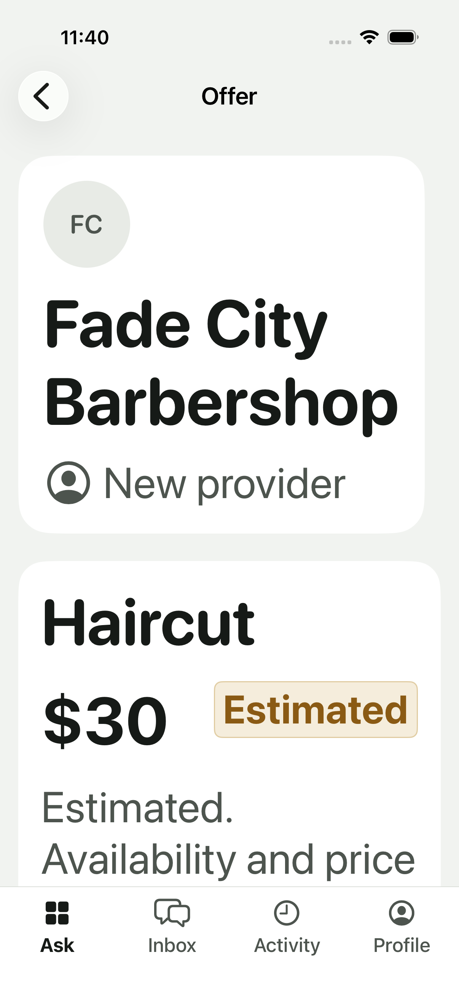 | 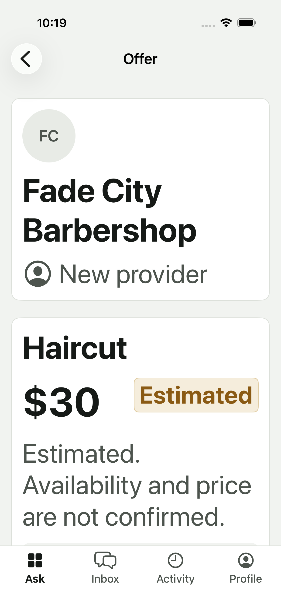 |
| Place answered | 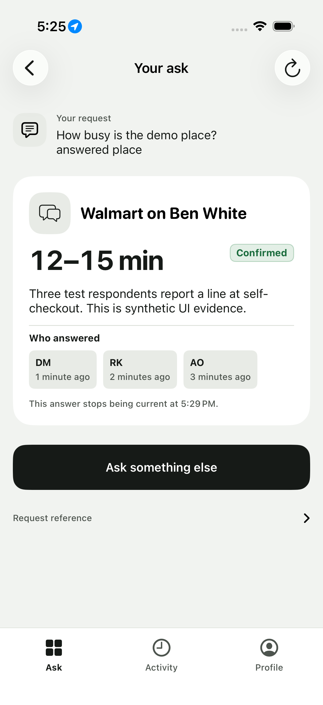 | 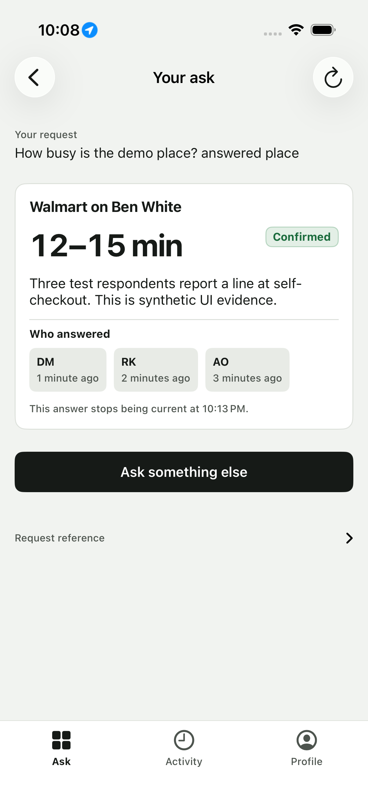 |
| Web answer (Not verified) | 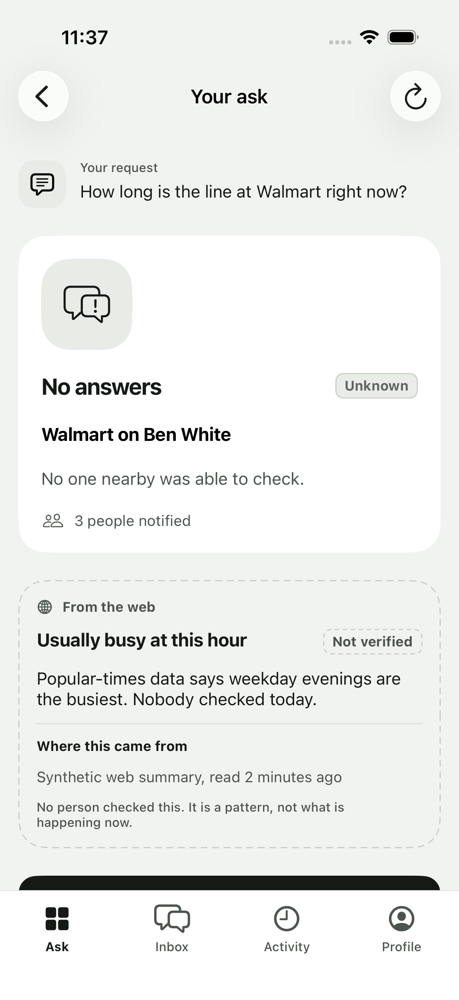 | 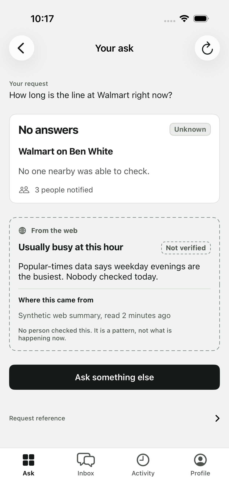 |
| Unknown, largest text | 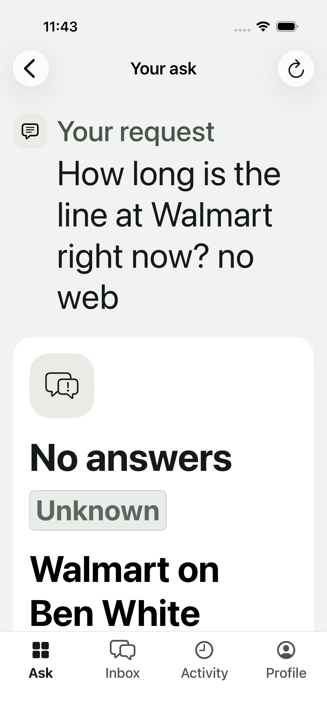 | 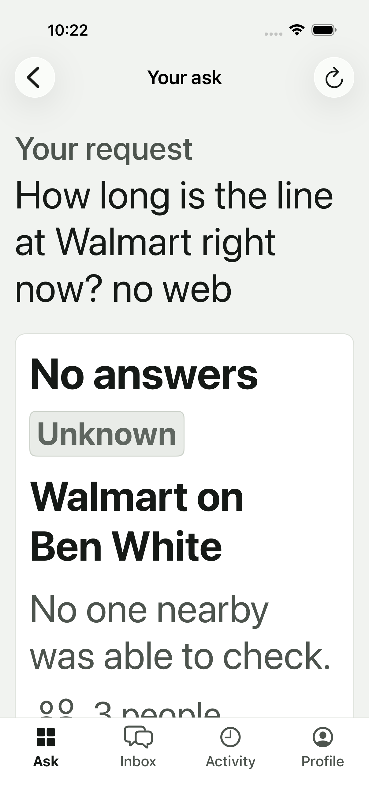 |
| Provider skills | 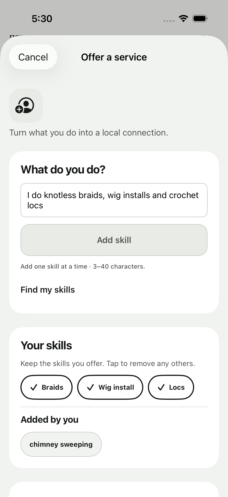 | 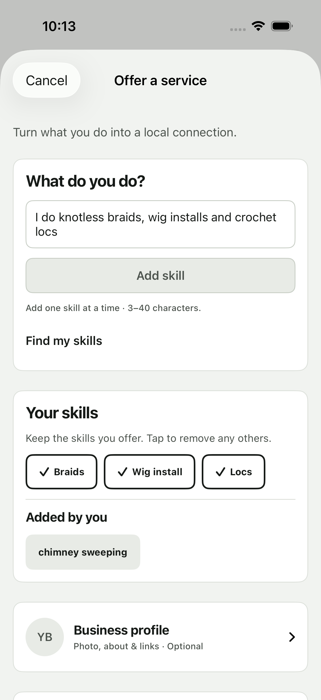 |
| Profile | 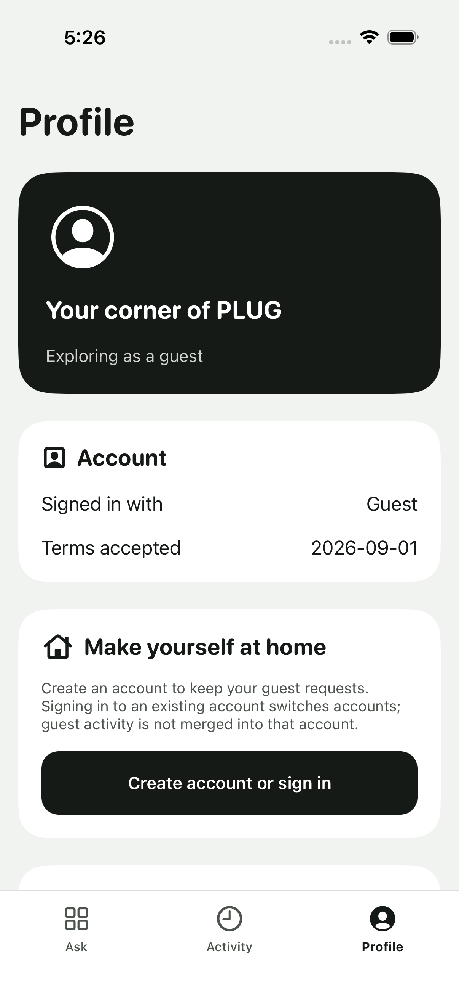 | 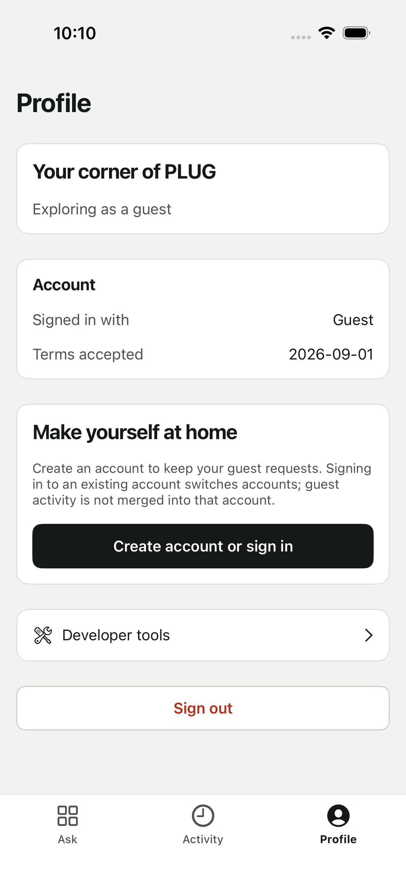 |

All 58 pairs are in `evidence/ui-pass/2026-11-14/before/` and `after/` under the same names.

## Verification

Final run, on the code at `f0fc636`:

- iOS unit tests: `xcodebuild test -scheme Plug` ran 67 tests: 0 failures, 1 skipped.
- Screenshot suite: `PLUG_UI_SIMULATORS=1 sh tools/run-phase2-ui-evidence.sh` passed all 7
  tests and wrote 58 screenshots. `testAccessibilityAudit` passes. On main the same audit
  failed contrast on the home card ("A little inspiration", "Find your next stylist").
  During round 1 the largest-text walk failed once while waiting for "View details" and
  passed when rerun; the final run passed without a retry.
- Design gate (§16.8, plug-design-gate) took three rounds:
  - Round 1 failed on 15 styling items.
  - Round 2 failed on a composer wrap regression and on text drawn in system black.
  - Round 3 passed for every screen group in scope: Ask home, service answers, offer
    detail, place answers, provider onboarding, Inbox, Activity and Profile.

  This is a design review result. It does not sign any gate.
- Not evidenced:
  - Offline, permission-denied and expired states have no captures.
  - There is no greyscale export of the truth-badge screens (§16.8 asks for one on iOS).
  - Disabled default-style buttons, such as "Retry update" and "Remove photo", were not
    captured.
  - Nothing was checked on a physical iPhone.

## Not changed on purpose

- Middle-dot meta strings and wording: UI tests read that exact text, and copy is Person Two's.
- iOS 26 glass toolbar buttons (back, refresh): drawn by the system.
- What the app shows: the client-set Unknown on a service no-result, "2 offers" counted on the
  client while server progress says 1, and the Inbox placeholder "Your business" / "YB". These
  are behaviour, not styling, and need the owner's decision.
- Sign-in screens body text (`WelcomeView`, Phase 1 code): left at the system body size.
- The home photo is generated stock imagery (ADR-012): kept by the owner as an exception.
